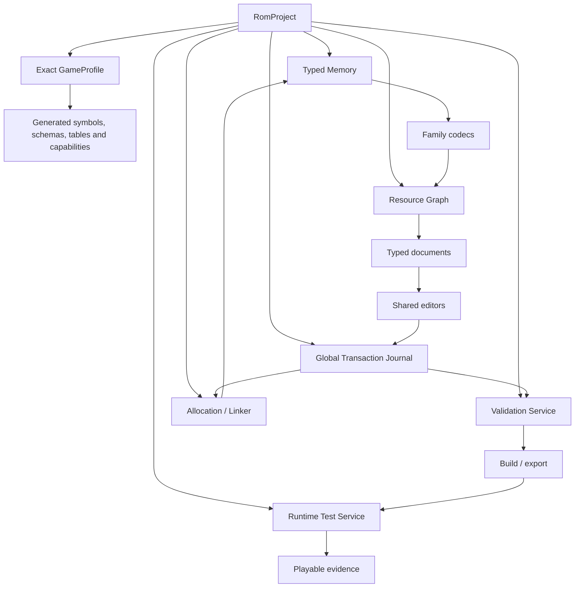

# Roadmap to a complete, playable Pokémon game studio

## Product goal

PUSH should let a user make semantic changes across a supported Pokémon game,
understand their impact, test them, and export an artifact that remains
structurally valid and playable.

“100% of the game” requires two complementary workflows:

### Exact ROM mode

For a precisely identified stock ROM or compatible manifest:

- decode known structures and resources;
- edit data and verified scripts/code;
- allocate/repoint within explicit constraints;
- preserve unknown bytes;
- validate and export a ROM/patch.

### Source project mode

For deep engine changes:

- open a pinned `pret`-compatible project and build configuration;
- import symbols, maps, schemas and source relationships;
- edit the same semantic documents or their C/ASM/RGBDS source;
- rebuild using the project toolchain;
- show the binary/resource diff;
- run the same validation and emulator suite.

Raw binary analysis cannot reconstruct every original label, macro, conditional
build choice or high-level intent. A professional tool should not promise
arbitrary executable-engine modification from stock bytes alone. Source project
mode is the credible route to complete developer power; ROM mode remains
essential for accessible forms, visualization, patching and legal local use.

## Definition of done

PUSH may call one exact game profile **complete and playable** only when:

1. every profile-declared data table is modeled or explicitly classified as
   opaque but preserved;
2. every pointer/reference type and incoming owner is indexed;
3. every writer has byte-identity and semantic round-trip tests;
4. all unknown bits/bytes survive a no-op edit;
5. all allocations are owned, conflict-free and reproducible;
6. all scripts/code/resources compile or fail atomically;
7. global validation reports no error;
8. the output reopens into the expected semantic graph;
9. the game boots in the matching emulator;
10. save/load and representative gameplay scenarios pass;
11. a progression suite covers title through ending and the edited systems;
12. every changed byte is explained by a semantic transaction or an explicit
    expert raw patch.

“All editor pages open” is not a completion criterion.

## Target architecture



### Core packages

```text
@push/core
  project, identities, resources, references, transactions, diagnostics

@push/binary
  memory, cursors, pointers, schemas, codecs, compression

@push/linker
  occupied ranges, allocation, repointing, ROM expansion, patch plans

@push/validation
  schema, domain, graph, export and runtime validators

@push/profile
  generated manifests, symbols, signatures, capability negotiation

@push/gba-rse
@push/gba-emerald
@push/gba-frlg
@push/gen1-rgb
@push/gen2-crystal
  family/engine codecs, renderers and validators

@push/ui
  shell, documents, panels, dialogs, menus, forms, viewport, accessibility

@push/emulator
  GBA and GB/GBC cores, symbols, test scenarios and semantic debugger

@push/plugin-sdk
  editor/profile/schema/validator/renderer extension contracts
```

Migrate incrementally. Existing globals can be wrapped behind modules before
being removed.

## Canonical data flow

```text
ROM/source
 -> exact profile
 -> typed codecs
 -> resource graph
 -> document
 -> editor draft
 -> validated semantic transaction
 -> linker/allocation plan
 -> bytes/source build
 -> whole-project validation
 -> reopen
 -> emulator scenarios
 -> export
```

No editor should bypass this flow for a semantic write.

## Workstream A — Trust and truthful capability

### A0. Immediate correctness gate

- [x] Fix the syntax error in `js/pokedex/editor.js`.
- [x] Add `node --check` for every non-vendored first-party script.
- [x] Make resource loaders reject, evict failures and support retry.
- [x] Dispatch `romloaded` only after the base workspace is initialized.
- [x] Give Battle, Pokédex, Sound, Animation and Emulator disposable event
  lifecycles.
- Make every declared workspace open in a browser integration test.
- [x] Give every declared workspace consistent File/Settings/Help and a
  maintained guide; consolidating the hand-wired descriptors remains WEB-006.
- Bundle icons locally; add a viewport meta tag and correct document language/
  landmarks.

Exit gate: ten sequential ROM replacements and one injected lazy-load failure
leave the app usable, with exactly one active handler per control.

### A1. Accuracy language

- [x] Add an enforceable first set of coverage states from
  [AUDIT_2026_WEB.md](AUDIT_2026_WEB.md#audit-vocabulary).
- [x] Show state/reason/repository provenance in navigation and editor headers;
  documents, references and export still need propagation.
- Keep heuristic discoveries disabled until an explicit Research workspace
  exists.
- [x] Remove synthetic/pointer-scanned animation results from ordinary editors.
- [x] Prevent unverified workspaces from opening through navigation or internal
  links; field-level capability enforcement remains.

Exit gate: a normal user cannot mistake a heuristic or illustrative preview for
decoded ROM data.

### A2. Compatibility contract

- [x] Replace broad detector workspaces with whole-ROM fingerprint capabilities.
- [x] Fail closed for unpinned/modified language/revision/table combinations.
- Document read, write, relocate and runtime status per resource/profile.
- Pin source repository/commit/build configuration.

Exit gate: every enabled action cites a validated profile capability.

## Workstream B — Profiles, schemas and the resource graph

### B0. Generated manifests

Create generators that consume `pret` build artifacts and curated schema
metadata:

- [x] Parse RGBDS/GNU `.sym`, normalize cartridge offsets, pin a clean checkout
  commit, and reject missing required symbols;
- [x] Build and fingerprint exact Red, Blue, Crystal Rev 0 and Emerald Rev 0
  ROMs from pinned `pret` revisions;
- [x] Commit deterministic table-root manifests and consume them in browser
  runtime profiles with field-for-field drift tests;
- `.map`, ELF and generated table extents where available;
- constants and table labels;
- file/CPU address and bank/section;
- entry counts, terminators and sizes;
- pointer/reference kinds;
- occupied/protected ranges;
- engine/version signatures.

First manifests:

1. [x] Emerald English exact revision used by the audit ROM;
2. FireRed English Rev 1;
3. [x] international Pokémon Blue/Red exact profiles;
4. [x] Crystal Rev 0;
5. Crystal Rev 1.

Exit gate: no core editor offset for these profiles is an uncited magic number.

### B1. Schema system

Schema features:

- fixed and variable records;
- arrays/tables and terminators;
- enums, bitfields and units;
- discriminated unions;
- near/far/GBA pointers;
- preserved unknown fields;
- validation and edit form metadata;
- source citations and profile variants.

Required initial corrections:

- RSE versus FRLG map layouts/headers;
- FRLG object template union;
- RSE/Emerald/FRLG script command variants;
- Gen I internal species mapping;
- trainer-party insertion/removal, ownership-aware relocation and Crystal
  AI/rematch/phone semantics (fixed Gen I and all four Crystal record variants
  already round-trip);
- family-specific cry records.

Exit gate: schema decode → encode without edits is byte-identical for every
golden fixture.

### B2. Resource graph

Index typed resources and relationships:

- [x] Establish immutable stable IDs and a fail-closed node/edge contract;
- [x] Carry source field/range, resolved or unresolved target, pointer/ID kind,
  confidence, provenance and rewrite policy;
- [x] Integrate the exact Red/Blue Species, Base Stats, Pokédex, description,
  cry, front-sprite, 165 moves, 72 evolutions, 728 level-up entries, 47 trainer
  classes, 415 trainer parties, 1,061 party members, 107 encounter documents
  and 706 slots across grass/water/fishing/static battles
  (4,398 nodes / 10,359 edges per ROM);
- [x] Add a first dedicated graph consumer: exact Red/Blue Move documents with
  inbound named learnset references and cross-editor navigation;
- [ ] Add graph providers for every remaining domain and family;
- [ ] Add one References/Problems UI and graph-aware cache invalidation,
  relocation and transaction impact reporting.

- symbols, tables, records, scripts, strings;
- maps, layouts, events, tilesets;
- species, moves, trainers, items, encounters;
- graphics, palettes, audio and animation;
- save structures;
- unknown/opaque owned ranges.

Every reference has:

- source resource/field/range;
- target resource or explicit unresolved state;
- pointer/ID kind;
- confidence/provenance;
- rewrite policy.

Exit gate: selecting any modeled resource shows complete inbound/outbound
references and unresolved edges are reportable errors/warnings.

## Workstream C — Transactions, allocation and validation

### C0. One global transaction journal — implemented foundation

The project now owns one applied-history journal. Editor-specific views are
owner scopes over that journal and cannot perform an Undo/Redo that would
reorder a newer transaction from another editor.

Each transaction records:

- semantic label;
- editor/resource/fields;
- before/after values and byte ranges;
- dependencies;
- validation result;
- allocation/repoint plan;
- time/author/plugin;
- exact compare-before-write and compare-before-undo data.

Editors may hold local drafts, but Apply commits one transaction. Export sees
all drafts and applied changes.

Exit gate: an edit in one editor, a related edit in another, undo/redo, export,
reopen and redo never silently overwrite newer bytes.

### C1. Allocation/linker

Replace fill scanning as the source of truth with:

- generated occupied/protected/free ranges;
- allocation reservations and ownership ledger;
- engine-specific alignment/bank/section constraints;
- inbound-reference rewrite;
- deterministic placement;
- optional ROM expansion with correct header/size handling;
- orphan/reclaim policy;
- compression-aware size planning;
- dry-run report and rollback.

Keep raw `0xFF` scanning only as an expert diagnostic.

Exit gate: parallel plans cannot claim the same bytes and every relocation lists
all rewritten owners.

### C2. Validator

Foundation implemented: the export snapshot now passes through a versioned
library with stable diagnostics for schema, registered domains, resource graph,
allocation ledger and artifact/checksum integrity. Errors prevent both ROM and
change-report download, and reports embed the result. The remaining work is to
register every modeled domain, add the Problems UI, and implement the gameplay
and reopen layers below. Exact Gen I and Crystal Species, Move,
evolution/learnset, Trainer and Encounter libraries now self-register live
providers. Audited Emerald/FireRed Species, Pokédex, LZ77 front graphics and
palettes now participate too, as do all four Emerald trainer-party layouts.
Other GBA domains remain.

Layers:

1. **Schema:** ranges, types, terminators, unions, reserved bits.
2. **Domain:** valid species/move/item IDs, party variants, probabilities.
3. **Graph:** pointers, bank constraints, dangling references, cycles where
   forbidden.
4. **Allocation:** overlaps, protected ranges, alignment, compressed decode.
5. **Gameplay:** map reachability, warp targets, required progression
   flags/items, battle validity.
6. **Export:** checksums, reopen equivalence and runtime test result.

Diagnostics need stable codes, severity, resource links and Simple/Nerd
messages.

Exit gate: export is blocked by errors and can deliberately override warnings
with an auditable expert decision.

## Workstream D — Coherent core editors

Build shared documents in dependency order. Do not add disconnected forms.

### D0. Finish the current foundation

- Hex/structure synchronized view;
- Code engine-specific script tables and honest CPU limitations;
- Map format divergences, profile names, complete lifecycle;
- Sprite asset ownership and compression safety;
- application-wide Help, bookmarks, headers, history and error handling.

### D1. Species spine

Implement:

- Species;
- Pokédex;
- evolutions/learnsets;
- graphics/palettes/icons;
- cries.

This single spine fixes the current numeric-name failures across Battle,
Pokédex and Sound.

Red/Blue and Crystal now have the first writable cry slices: the canonical
Species identity owns an exact three-byte `CryData` or six-byte
`PokemonCries` document shared by Sound and Pokédex, with bounded values,
compare-before-write and Undo/Redo. Crystal also owns exact names, `BaseData`
and four-bank Pokédex text, plus exact LZ3 front pictures and native palettes.
Verified Crystal BaseData fields are selectively
writable while opaque/reference/TM bytes are preserved. Channel programs,
back pictures/animation/recompression, Move-record editing and the equivalent GBA resources remain part of
D1.

Generation III now has the first unified asset side of this spine. The
family-owned provider contributes all 411 names, front/back graphics, battle
palettes, Pokédex records/text, evolution tables, machine masks and level-up
lists to one graph. Emerald additionally contributes menu icons/palettes,
footprints and cry mappings. Sprite reads those resources directly while
Battle keeps scene coordinates/composition, preventing editor coupling from
hiding otherwise valid graphics. GBA Base Stats/abilities/types, regional
order, deterministic recompression and remaining manifests are still required
before D1 exits.

Exit gate: selecting a species in any editor resolves the same identity and
real assets on Emerald, Blue and Crystal.

### D2. Battle content spine

Implement:

- Moves/effects;
- Trainers/classes/party variants;
- Encounters;
- Items/economy;
- type chart/abilities where applicable.

Exit gate: “Open battle team” from a map event displays correct named Pokémon,
moves/items and trainer data, can be edited, and passes a runtime encounter.

### D3. World/story spine

Implement:

- complete maps/headers/scripts;
- tilesets/metatiles/palettes/animations;
- actual Town/Region/Fly map;
- text/localization catalog;
- script/story/flag/variable graph;
- shops, gifts and trades.

Exit gate: a route can be redesigned end-to-end and progression/reachability
validation passes.

### D4. Media spine

Implement real:

- Sound;
- Animation;
- battle scenes;
- UI/font/title/intro/credits.

Exit gate: every preview declares exact native source and matches golden emulator
captures/audio traces.

### D5. Save spine

Implement family save codecs, checksums/redundancy, player/party/boxes/bag/flags
and generation-specific state.

Exit gate: imported and edited saves load, save, reset and reload in both GBA
and GB/GBC validation cores.

## Workstream E — Web UX

### E0. Resource-oriented shell

- project overview landing page;
- grouped navigator and command palette;
- recent/favorite resources;
- breadcrumb/back stack;
- project bar with profile, accuracy, dirty, Validate, Run and Export;
- status bar with selection/address/zoom/diagnostics.

### E1. Shared editor framework

- capability-driven `EditorDescriptor`;
- dockable responsive panels;
- one accessible window/dialog/menu/tab/form system;
- shared viewport/gesture service;
- layout persistence by editor and viewport;
- full-screen/focus without lost camera/panel state;
- Problems and Changes panels.

### E2. Simple experience

- task templates and named choices;
- native previews;
- safe defaults and impact summaries;
- field grouping/units/help;
- guided validation and recovery;
- no unexplained offsets/IDs.

### E3. Nerd experience

- raw/semantic split view;
- symbols, xrefs, structure and allocation inspectors;
- command palette and keyboard workflows;
- source, compile diff and control flow;
- batch query/transform API;
- profile/plugin development tools.

Exit gate: both experiences edit the same document and produce identical
transactions for the same semantic change.

## Workstream F — QA and runtime proof

### F0. Continuous integration

Required jobs:

- syntax/lint/format/static type checks;
- SCSS build;
- HTML/landmark validation;
- unit/property/round-trip tests;
- dependency/license/SBOM audit;
- link/documentation validation.

Split the single large source-contract test file into behavioral suites without
losing its useful byte fixtures.

### F1. Browser quality

Use Chromium, Firefox and WebKit for:

- every workspace and exact profile;
- ROM load/failure/retry/replacement;
- edit/undo/redo/switch/export/reopen;
- dialogs, menus, tabs, panels and history;
- mouse, trackpad, pointer cancellation, touch and keyboard;
- responsive widths and DPR 1/2;
- accessibility automation plus keyboard/screen-reader smoke;
- visual golden captures.

### F2. Golden ROM/resource suite

For each exact profile:

- expected table counts and named samples;
- decode/encode identity;
- map/sprite/Town Map/battle/animation screenshot goldens;
- audio command/trace goldens;
- corrupt/malformed fixtures;
- allocation and patch conflict cases.

Commercial ROM bytes must not enter the repository. Generate fixtures from
legal source builds or synthetic minimal data, and let local opt-in audit scripts
test user-owned ROMs without logging bytes.

### F3. Emulator validation

Integrate appropriate GBA and GB/GBC cores with:

- deterministic inputs/RNG where possible;
- savestates/checkpoints;
- symbol/resource-aware breakpoints;
- screenshot/audio/memory assertions;
- scenario recording;
- clean reset and save isolation.

Minimum scenarios per profile:

```text
boot -> title
new game -> first map
save -> reset -> load
map transition and warp
dialogue/script
wild battle
trainer battle
party/bag/Pokédex/Town Map
edited resource-specific scenario
progression checkpoints -> ending
```

Exit gate: export includes the exact validation suite/version and its result.

## Workstream G — Project, recovery and delivery

### G0. Portable project format

`.push-project` should contain:

- format/schema version;
- source ROM fingerprint and exact profile;
- semantic transactions/byte patch;
- imported source/symbol manifests;
- bookmarks/notes;
- open documents/layout;
- validation history;
- plugin/tool versions.

Do not include the commercial ROM by default.

Use IndexedDB for automatic recovery journals with retention and explicit
clear/export controls.

### G1. Artifact formats

Support deliberately:

- edited ROM;
- PUSH semantic/byte report;
- portable project;
- selected standard patch formats after correctness review;
- source-project commit/patch in source mode;
- validation report.

Every artifact records compatible source identity and refuses an incompatible
base.

### G2. Offline/security/legal readiness

- local icon/assets and no required network;
- Content Security Policy;
- untrusted ROM/JSON/Markdown size/schema handling;
- pinned dependencies and license notices;
- SBOM;
- project license and contributor policy;
- privacy statement: ROM bytes remain local unless explicitly exported.

## Profile delivery sequence

Complete one exact profile through all gates before widening titles:

1. **Emerald English** — strongest current GBA data/profile path.
2. **Red/Blue international** — prove Gen I banking/internal identity.
3. **Crystal Rev 0/1 separately** — prove Gen II events/LZ3/time.
4. **FireRed English Rev 1** — prove FRLG structural variants.
5. **Ruby/Sapphire** — new exact RSE profiles.
6. **LeafGreen and other revisions/languages.**
7. **Yellow and Gold/Silver** as distinct engine profiles.

Breadth should not outrun truth.

## Milestone scorecard

| Milestone | Evidence required |
| --- | --- |
| Trustworthy inspector | exact profile; typed graph; no fake data; read goldens |
| Safe data editor | transaction, round trip, validator, reopen |
| Relocatable editor | ownership graph, linker, overlap/bank tests |
| Playtestable editor | matching emulator scenario passes |
| Complete profile | inventory 100%; unknowns preserved/classified; progression suite |
| Perfect Tool release | multiple complete profiles; accessible web UX; project/source/plugin ecosystem |

## Immediate ordered backlog

Completed foundations are tracked in
[AUDIT_BACKLOG_2026.md](AUDIT_BACKLOG_2026.md#verified-progress--2026-07-28).
The next executable order is:

The 2026-07-29 continuation closed the Generation III fixed-record portion of
Move Editor for the exact Emerald profile: 354 records/names, selective writer,
explicit trainer references and animation-pointer navigation. FireRed Rev. 1
passes the ROM-level fixed-table audit but remains capability-gated until item
3 supplies its independent source manifest. Effect, TM/HM, learnset and audio
graphs remain part of items 6 and 12.

1. Add real-browser workspace smoke tests for every exact profile and retain
   the existing syntax/lifecycle/loading gates.
2. Extend Red, Blue, Crystal Rev 0 and Emerald manifests with counts, extents,
   pointer ownership, signatures and occupied/protected ranges.
3. Generate independent Crystal Rev 1 and FireRed Rev 1 manifests.
4. Implement the global Resource Graph and Transaction Journal.
5. Replace filler scanning with an ownership-aware linker and whole-project
   validator.
6. Finish the Species spine: base data, graphics, cry, Pokédex,
   evolutions/learnsets and references for Emerald, Gen I and Crystal.
7. Finish Trainer and Encounter documents and connect map event → script →
   trainer → party → battle.
8. Complete the world spine: all map properties, encounter/music/weather,
   tileset/palette animation and actual Town/Region/Fly resources.
9. Build Project Overview, Resource Navigator and Changes/Problems/Validation.
10. Implement matching GB/GBC runtime validation and deterministic
    export/reopen/emulator scenarios.
11. Create portable project/recovery artifacts and compatible
    symbol/manifest import.
12. Continue domain breadth in the order specified by
    [PERFECT_TOOL_AUDIT_2026.md](PERFECT_TOOL_AUDIT_2026.md#prioritized-closure)
    and [PERFECT_TOOL_EDITOR_CATALOG.md](PERFECT_TOOL_EDITOR_CATALOG.md).
